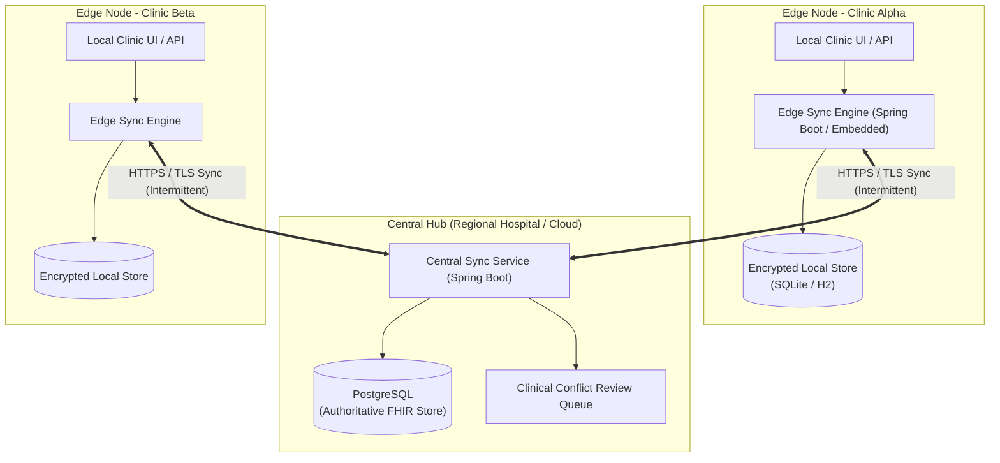

# Architecture: clinic_sync

> **Status:** Draft / Phase 0 Outline  
> **Target Phase:** Phase 1 (Architecture & Design)  
> **Last Updated:** 2026-10-27  

---

## 1. High-Level Topology (Hub-and-Spoke)

The system consists of independent Edge Nodes (deployed at remote clinics) communicating with a Central Server (deployed at a regional datacenter or cloud) over an unreliable network.

---

## 2. Modules & Codebase Structure

The multi-module Maven structure planned for Phase 2:

- `clinic-sync-common`: Shared domain models, clock abstractions (HLC/Lamport/Vector), sync protocol DTOs, encryption/crypto helpers, and invariants definitions.
- `clinic-sync-edge`: Embedded Spring Boot application running at the clinic. Local storage (SQLite/H2 encrypted), local FHIR API, outbox/change journal, edge sync client.
- `clinic-sync-central`: Spring Boot service with PostgreSQL. Central sync endpoint, authoritative version resolver, conflict review manager.
- `clinic-sync-sim`: Chaos and simulation harness for spinning up multiple edge nodes, network partition injectors, packet loss, clock skew injectors, and property-based test runners.

---

## 3. Data Model & FHIR Scope

Primary FHIR R4 Resources:
- `Patient`: Demographics, identifiers, active status.
- `Encounter`: Clinic visits, timestamps, provider references.
- `Observation`: Vital signs, clinical measurements.
- `AllergyIntolerance`: Critical allergies, clinical status, verification status.
- `Consent`: Patient consent directives for data sharing.
- `AuditEvent`: Tamper-evident record of local creations, edits, merges, and sync transactions.

---

## 4. Key Architectural Decisions (To be decided in Phase 1 ADRs)
1. **Clock Strategy:** Logical vs. Hybrid Logical Clocks (HLC) vs. Version Vectors.
2. **Storage Engine for Edge:** SQLite (SQLCipher) vs. H2 (encrypted).
3. **Change Tracking & Sync Protocol:** Outbox pattern, change logs, and push-pull delta protocol.
4. **Merge & Conflict Resolution Strategy:** Field-level CRDT/LWW rules vs. three-way merge vs. human review queue.
