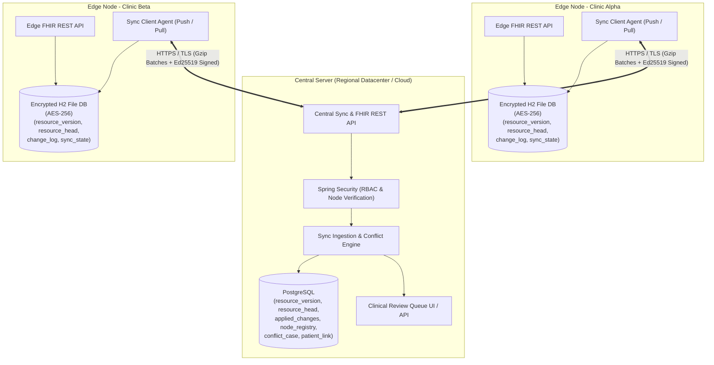
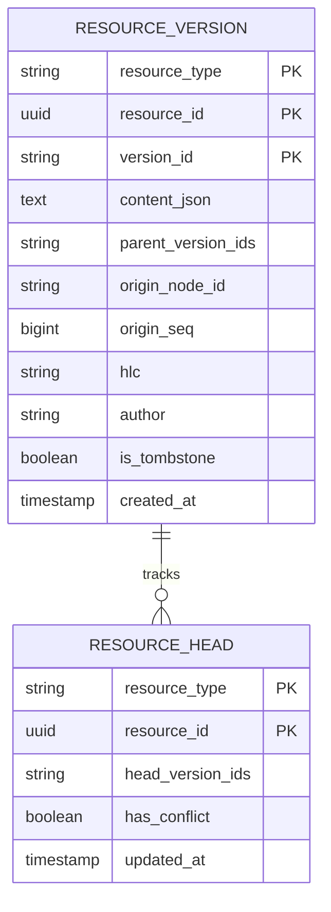
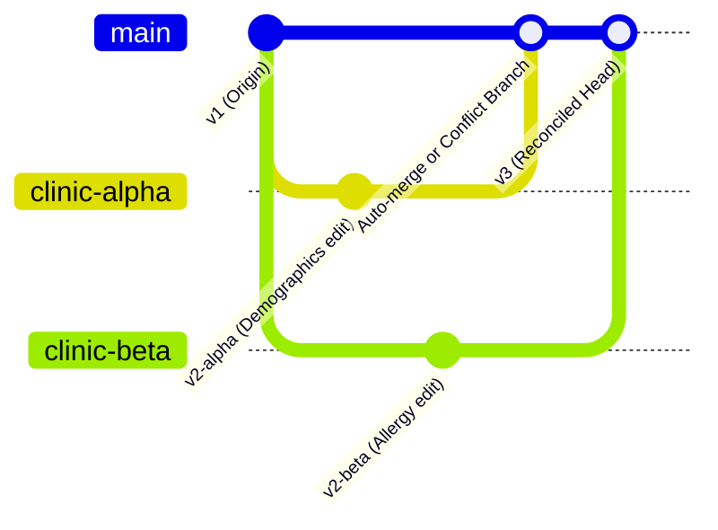
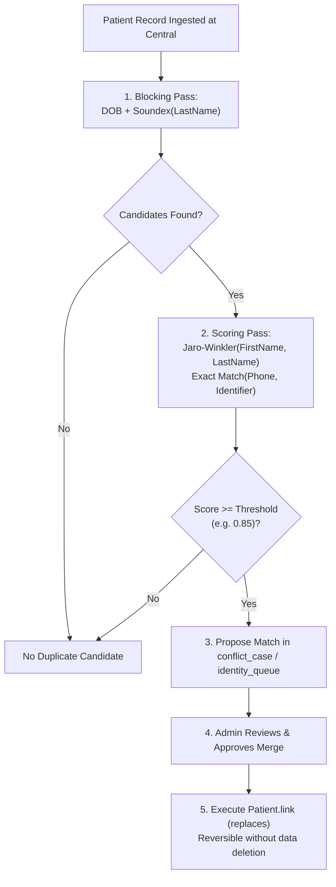

# Architecture & System Design: clinic_sync

> **Status:** Active / Accepted  
> **Last Updated:** 2026-10-27  

---

## 1. System Topology & Module Structure

`clinic_sync` implements a robust **Hub-and-Spoke** distributed architecture. Edge nodes operate autonomously at rural clinic facilities, while a Central Server provides authoritative convergence, conflict governance, and identity deduplication.



### Module Boundaries
```
offline-fhir-sync/
  ├── common/          # Zero Spring dependencies: HLC, sync models, canonical JSON,
  │                    # Ed25519 signing helpers, merge rules, UUIDv7
  ├── edge-node/       # Spring Boot: local FHIR API, AES-encrypted H2 store,
  │                    # change_log outbox, background sync push/pull agent
  ├── central-server/  # Spring Boot: PostgreSQL store, sync endpoints, node registry,
  │                    # conflict engine, identity deduplication, audit logging
  └── sim/             # Multi-clinic simulator, fault injection (partitions, skew,
                       # drops), jqwik invariant test suite, benchmarks
```

---

## 2. Core Data Model & Relational Schema

Both edge and central share the core versioned resource representation, with specialized journal tables adapted per module. Schema migrations are managed by Flyway.

### Shared Tables (Edge and Central)



- **`resource_version`:** Append-only history table. A record is **never** updated in place. Every modification creates a new row with:
  - `resource_type`: e.g., `Patient`, `Observation`, `Encounter`, `AllergyIntolerance`, `Consent`, `AuditEvent`.
  - `resource_id`: Globally unique UUIDv7 minted by the creating client.
  - `version_id`: Monotonically incremented version string (e.g. `1`, `2`, `3`) or UUIDv7.
  - `content_json`: Validated FHIR R4 JSON payload.
  - `parent_version_ids`: Comma-separated parent version IDs forming a Version Directed Acyclic Graph (DAG).
  - `origin_node_id`: Edge node or central identifier where this write originated.
  - `origin_seq`: Dense, strictly increasing sequence number on the origin node.
  - `hlc`: Hybrid Logical Clock string (`<physical_ms>:<counter>:<node_id>`).
  - `author`: Clinician or system identifier responsible for the write.
  - `is_tombstone`: Boolean indicating logical deletion.
- **`resource_head`:** Points to the active head version(s). If concurrent branching occurs, `head_version_ids` contains multiple comma-separated IDs and `has_conflict` is set to `true`.

### Edge-Specific Tables
- **`change_log`:**
  - `seq` (BIGINT AUTO_INCREMENT PK): Local sequence number.
  - `resource_type`, `resource_id`, `version_id`: Reference to the `resource_version` row created locally.
  - `created_at`: Timestamp of local commit.
- **`sync_state`:**
  - `peer` (VARCHAR PK): Central server identifier.
  - `last_pushed_seq` (BIGINT): Highest contiguous `origin_seq` acknowledged by central.
  - `last_pulled_global_seq` (BIGINT): Central `global_seq` cursor up to which edge has applied down-sync deltas.
  - `last_sync_attempt`, `last_sync_success`: Diagnostics.

### Central-Specific Tables
- **`applied_changes`:**
  - `origin_node_id` (VARCHAR): Origin node identifier.
  - `origin_seq` (BIGINT): Dense sequence number on origin node.
  - `global_seq` (BIGINT GENERATED ALWAYS AS IDENTITY PK): Monotonic central timeline cursor.
  - `resource_type`, `resource_id`, `version_id`: Reference to applied version.
  - *Constraint:* `UNIQUE(origin_node_id, origin_seq)` ensures absolute idempotency.
- **`node_registry`:**
  - `node_id` (VARCHAR PK): Unique edge identifier.
  - `public_key` (TEXT): Ed25519 public key (Base64).
  - `clinic_scope` (VARCHAR): Clinic identifier for selective data synchronization.
  - `status` (VARCHAR): `ACTIVE`, `SUSPENDED`, or `REVOKED`.
- **`conflict_case`:**
  - `case_id` (UUID PK): Unique case ID.
  - `resource_type`, `resource_id`: Target resource.
  - `conflicting_version_ids` (TEXT): Competing DAG leaf versions.
  - `status` (VARCHAR): `OPEN`, `RESOLVED`, `IGNORED`.
  - `resolution_version_id` (VARCHAR): Version created by human resolution.
- **`patient_link`:**
  - `canonical_patient_id` (UUID): Surviving/target patient ID.
  - `linked_patient_id` (UUID): Merged/source patient ID.
  - `link_type` (VARCHAR): `replaces` | `refer`.
  - `created_at`, `created_by`, `is_active`: Fully reversible link registry.
- **`audit_event`:**
  - Dedicated table mirroring FHIR `AuditEvent` for reads, writes, merges, and sync transactions.

---

## 3. Sync Protocol & State Machine

The sync protocol operates in two distinct phases: **Push (Upstream)** followed by **Pull (Downstream)**. All batch payloads are serialized to Canonical JSON, gzip-compressed, and signed with Ed25519.

```mermaid
sequenceDiagram
    autonumber
    participant Edge as Edge Node (Clinic Alpha)
    participant Central as Central Server Hub

    Note over Edge: 1. Push Phase
    Edge->>Edge: Read change_log where seq > last_pushed_seq (batch size e.g. 50)
    Edge->>Edge: Generate Batch ID, compute Canonical JSON, sign with Ed25519 private key
    Edge->>Central: POST /api/v1/sync/push (Gzip JSON + Ed25519 Signature + BatchId)
    Central->>Central: 1. Lookup node in node_registry; verify status is ACTIVE
    Central->>Central: 2. Verify Ed25519 signature on canonical payload
    Central->>Central: 3. Verify HLC future drift within bound (e.g. <= 5 min)
    Central->>Central: 4. Deduplicate using applied_changes(origin_node_id, origin_seq)
    Central->>Central: 5. In single DB transaction: insert resource_version, update head, assign global_seq
    Central-->>Edge: 200 OK { batch_id, highest_contiguous_origin_seq, applied_count }
    Edge->>Edge: Update sync_state.last_pushed_seq = highest_contiguous_origin_seq

    Note over Edge: 2. Pull Phase
    Edge->>Central: GET /api/v1/sync/pull?since=last_pulled_global_seq&limit=50&scope=clinic_scope
    Central->>Central: Query applied_changes where global_seq > since (ordered by global_seq ASC)
    Central-->>Edge: 200 OK { changes: [...], max_global_seq, has_more: false }
    Edge->>Edge: In single DB transaction: apply changes idempotently to local store
    Edge->>Edge: Update sync_state.last_pulled_global_seq = max_global_seq
```

### Protocol Invariants & Guardrails
1. **Contiguous Acknowledgment:** Central calculates the highest *strictly contiguous* sequence `origin_seq` applied without gaps. Edge only advances its cursor to this value.
2. **Gap Detection:** If central detects a missing `origin_seq` (e.g. receives seq 4 after seq 2), it accepts up to seq 2 and requests a replay of missing sequences.
3. **Resumability & Retries:** Edge sync agent runs on a scheduled cadence with exponential backoff and randomized jitter upon network failure.
4. **Selective Sync:** Central filters pull payloads so edge nodes only receive patients and encounters associated with their assigned clinic scope or regional transfer consent.

---

## 4. Version DAG & Conflict Resolution Architecture

When concurrent writes happen offline at different clinics, the version history forms a directed acyclic graph (branching heads).



### 3-Tier Merge Rules
1. **Tier 1: Additive & Commutative (Auto-Merge):**
   - `Encounter` and `Observation`: Clinically immutable. Observations recorded concurrently at two clinics are distinct historical events. Both versions are preserved as active heads or merged into an additive set without overwriting values.
   - Any clinical modification or correction must be submitted as a new version explicitly coded with `Observation.status = 'entered-in-error'`.
2. **Tier 2: Demographic Field-Level LWW:**
   - `Patient` Demographics: Granular field-level Last-Write-Wins based on HLC timestamps (e.g., Clinic A updated address at $HLC_1$, Clinic B updated phone at $HLC_2 > HLC_1$; both fields apply non-destructively).
   - Identifiers merge as a set union without deduplication loss.
3. **Tier 3: Clinical Contradictions (Human Review Queue):**
   - Conflicting clinical declarations (e.g. `AllergyIntolerance` clinicalStatus conflicting between `active` vs `refuted` or substance severity mismatches).
   - The conflict engine flags `resource_head.has_conflict = true` and inserts a case into `conflict_case`. Both versions remain readable. The case is presented via the Central Review API for medical officer adjudication.

---

## 5. Patient Identity & Deduplication

When clinics are partitioned, the same human patient may be registered twice under slight spelling variations.



- **Reversibility Guarantee:** A merge never alters foreign keys destructively. The subordinate patient is linked via FHIR `Patient.link.type = 'replaced-by'`. An unmerge operation simply revokes the active link entry in `patient_link` and emits an unmerge audit event, completely restoring separate identities.

---

## 6. Security & Cryptographic Architecture

- **Encryption at Rest:** Edge H2 database files are encrypted using AES-256 (`CIPHER=AES` in JDBC connection URL). The encryption secret is read from the `CLINIC_EDGE_DB_KEY` environment variable or a secure secret file.
- **Node Authentication & Signing:**
  - Each edge node generates an Ed25519 keypair (`java.security.KeyPairGenerator.getInstance("Ed25519")`).
  - Edge public key is registered in Central's `node_registry`.
  - Every push batch includes the node's Base64 Ed25519 signature over the Canonical JSON representation of the batch.
- **Transport Security:** All communication occurs over TLS (HTTPS). Self-signed certificates are generated for local development and test fixtures.
- **Node Revocation:** Central administrators can set `node_registry.status = 'REVOKED'`. The central sync filter immediately rejects any subsequent payload signed by that key.
- **Access Control (RBAC):** Spring Security enforces three core roles:
  - `ROLE_CLINICIAN`: Read/write local FHIR clinical resources.
  - `ROLE_CLINIC_ADMIN`: Manage local edge sync status and diagnostics.
  - `ROLE_CENTRAL_ADMIN`: Access central conflict review queue, node registry, and patient merge operations.
- **Consent Enforcement:** FHIR `Consent` resources are evaluated prior to transmitting patient records during pull sync, preventing unauthorized regional dissemination.
